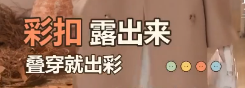
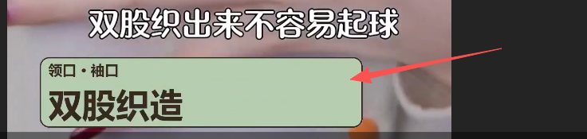
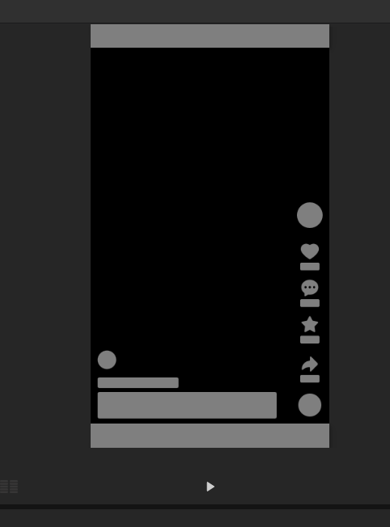

# 样例、证据与返修

produce 模式必读；适用于本商品切片流程。判断效果由调用方负责，插件只保存可追溯证据和状态，不会自动看懂画面或听感。用户最新要求优先。

## 已认可的视觉样例

以下来自用户提供并明确认可的**花字局部样式**，不是对某一整片的验收。示例配色可替换；片内主题统一，不把橙黄配色强制用于所有视频。

合格点：内容重点与字重/字号对应；透明底；描边统一；主辅字不是同一字号；留白让衣服仍可见。静态图不能证明动效、时序、音效或安全区已合格，实际片段另验。主体和小字不是每条都必须出现。

## 可携带的钩子动态样例

[已认可的纯展示配独立原声钩子](../assets/quality-examples/accepted-display-hook.mp4) 为原有 3 秒文件的原样副本，没有为本次更新重新剪辑。只示范自然展示与独立声音的关系；其中旧文字布局不是新规则的全部合格证明，后续花字按当前布局规则做。

[不合格画面](../assets/quality-examples/rejected-talking-hook.jpg) 来自本次被否定的开头：没有完整全身展示。静态图不能独立证明持续讲话；判断口型需连续查看候选预览，不能从一张截图推断。字幕文字与独立声音还需逐项核对。

样例文件、哈希、适用范围及不作为通用素材复用的限制见 [样例目录](../assets/quality-examples/examples.json)。样例帮助比较，不提供可复制的 pass。

## 可执行的对照判断

| 项目 | 合格设计示例 | 不合格与返修 |
|---|---|---|
| 纯剪辑钩子 | 约3秒自然全身展示，独立原声是一句完整、有感染力的推荐/感叹；字幕式花字每行在画布50%居中，1个点睛音效 | 人只到膝盖且一直对口讲话，却记作“全身纯展示”；普通参数介绍冒充强情绪。重选画面/原声，素材确实不足就报告缺口，不能通过标签改名验收 |
| 正文承接 | 先完整讲清一个点，再接该点演示；一个约5秒说明可保留同源连续声床，在自然动作处接一段真实近景 | 钩子后连续一秒多换卖点，或多个场次发型、下装反复跳变。优先同场次，删掉不必要的切镜；不是再加转场遮掩 |
| 重点镜头 | “织得密”对应织纹近景；“肩型”对应肩线和肩背动作；“彩扣”对应扣子细节 | 连续站讲配10个文字条，假装有10种演示。建立台词—动作—源时间窗对应表；数码放大不能凭空创造细节 |
| 花字变化 | 钩子居中下方；正文重点字+小辅助句、两段错落排版、短下划线分别承担不同角色；同片主题一致 | 每条同位置、同字号、同两行、同淡入淡出。至少比较层级、构图、进入方式，不用换颜色代替设计；不设机械轮换比例 |
| 花字动态 | 0.16秒轻弹入，约1.5–2.5秒可读停留，0.12秒退出；下划线晚主字0.12秒出现 | 只有透明PNG+淡入，也声称做了丰富花字动画。保存实际非恒定 scale/x/y 关键帧，检查最大占位；不是每条都弹跳 |
| 声音 | 按每个点的同期人声校准短音效，等音量 A/B 能分辨且不压字；目标差值只是初始调音参考 | 全部音效统一乘0.35；看到音轨存在便通过。对照 with/without/delivered 样本，遮蔽警告先试听或调音再验 |
| 文字互斥 | 自加普通字幕在花字出现时隐藏；烧录字幕单独记录和避让，尽量选干净版本或减少重复花字 | 源字幕仍在，却报告“字幕与花字全部互斥”。不能用普通轨道隐藏烧录文字；换源、换文案/时间或明确保留情况 |

这些时长与层级是可调整的设计例子，不是自动合格分数。没有对应画面、原声和实际效果，不能只抄例句。

## 先验证“看的是正确秒数”

使用 `media_frames_at` / 队列 frames 证据。保存源哈希、requested_source_time、actual_source_time、absolute_pts、time_base；读取结果而不是自己贴秒数标签。首帧、峰值动画、退出和切点两侧均需覆盖。选定区间另看连续音画，抽帧不证明动作/台词完整。

禁用错误写法 `int(seconds / av.time_base)`：PyAV 的全局 time_base 是每秒刻度数，不能这样换算。使用 stream 时应为 `int(seconds / float(stream.time_base))`，seek 到关键帧后继续解码至目标 PTS。只取 seek 后第一帧仍可能错误。长段序列若重复，先核对 PTS 和帧哈希；真实静止也会相似，不凭相似度单独判错。插件发现错位会拒绝生成标作已核验的证据；VFR 大间隔需人工解释，不偷偷放宽。

## 0.5.0 验收入口

纯剪辑先执行 [分阶段工具](source-only-stages.md)。delivery_inspection_submit 在共享重任务队列里生成绑定本次成片的画面、听音及逐选区声音证据；成功后 delivery_review_form 返回逐项 not_checked 表。实际看/听后填表，再 delivery_review_record(inspection_job_id=...)，最后 commerce_delivery_get。

not_applicable 仅用于插件依据实际时间线判定不存在的钩子/音效项目；不能豁免人物、正文、成片声音等必查项。任意 JSON 文件、自己的通过宣言或旧成片检查不能代替绑定检查任务。钩子画面通过须明确记录 full_body_visible、natural_display、no_continuous_speaking、burned_captions_compatible。

已失败项只有相应内容及输出真正变化后才能重新通过。仅增加 revision、改变无关音量/花字、重复旧输出不能解除失败。检查方法与证据绑定只能减少误判，不能代替真实的视听判断；能力不足就保留待审阅。

## 交付状态与返修闭环

1. 保存素材资格、候选钩子及取舍、卖点区间表、花字/音效表。可用候选多时比较至少两条原声；不要为了凑候选虚构素材。未找到全身展示或足够细节，明确缺口。
2. 队列预览后连续检查钩子接正文、每个主题切换和结尾；检查花字峰值位置/原字幕/衣服。对发现的问题调用 `delivery_review_record` 保存 `fail`、证据路径和具体 `repair_action`。未看的项目用 `not_checked`。
3. 内容不合格应修改时间线后提交**新渲染任务**。`render_retry` 仅处理执行失败，仍使用旧快照，不能修复难看的剪辑。所有重试继续走并发1队列。
4. 新成片上运行源区间/最终无声检查、`audio_review_submit(render_job_id=...)`；检查返回的真实 warning，而不是仅看任务 succeeded。未试听不可把 `sfx_audibility` / `final_speech` 标为 pass。
5. `delivery_review_record` 记录14项固定检查：`source_audio`、`source_frame_timestamps`、`hook_picture`、`hook_voice`、`hook_body_continuity`、`selling_point_evidence`、`body_continuity`、`typography`、`safe_layout`、`text_overlap`、`transition`、`final_picture`、`final_speech`、`sfx_audibility`。每项提供 status、note、evidence_paths；失败加 repair_action。检查范围和秒数写在 note/证据里。
6. 每项另记 `method`：measurement、frame_review、continuous_review、listening 或 user_feedback；确实不适用才用 not_applicable，并附本次需求依据。hook_voice、final_speech、sfx_audibility 的通过必须有实际 listening/user_feedback，测量或 ASR 不能代替试听。插件绑定渲染 ID、revision、成片 SHA-256、证据 SHA-256，保留历次记录。`delivery_review_get` 给出 `needs_review` / `needs_repair` / `stale` / `preview_reviewed` / `ready`。缺项不能通过；已失败的内容检查必须修改时间线并取得新版渲染，不能改填 pass/not_checked 清除失败；换文件、改时间线或证据后旧结论失效；预览通过也不是最终成片通过。
7. 信号缺失必须修复。其他检测警告只有经过具体检查才能通过 `warning_resolutions` 单条说明解决，不能批量写“忽略”。音效遮蔽警告尚未试听不能豁免。合格样例只是比较基准，不能直接复制 pass。

允许交付明确标注“待试听/待复核”的可播放版本，不把未完成项写成全通过。无需因主观听感待确认而停止已经授权的备料、渲染和技术修复；最终说明实际完成范围。若返修多次仍无可用素材，保留缺口和失败证据，按既有授权补料，不重复导出同一失败方案。
