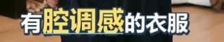
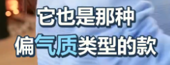
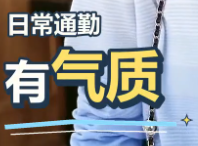
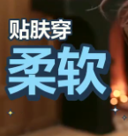
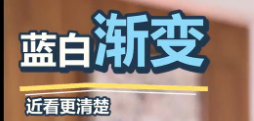
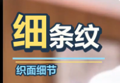
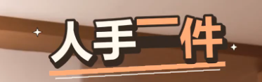
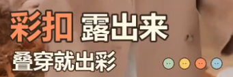

# 用户花字原图：先看 PNG，再设计

这 8 张局部截图由用户于 2026-10-21 提供，按原始 PNG 保存，未重画、改色、抠图或压缩。用于本商品视频流程的花字风格参考；不证明画面安全区、动效或声音已经合格。

## 查看与使用

1. 本次第一次设计花字前，必须用宿主实际提供的图片查看/注入工具打开下面全部 8 张 PNG，让图像像素进入模型上下文。支持多图时可批量查看。读取 Markdown、文件信息、OCR 或文字概括均不能替代这一步；不要把 PNG 当文本文件读取。
2. 图片路径相对本文件所在目录解析；工具需要绝对路径时，先根据当前安装的 Skill 位置解析。不要使用用户原来的剪贴板临时路径。图片已在本次上下文实际显示时无需重复打开；若无法查看，明确记录“花字参考未查看”，不要声称已按图对照合格。
3. 参考 01–02 组织字幕式花字，参考 03–08 设计正文主辅层级与装饰。开头字幕式、正文穿插非字幕式；依据卖点选择，不机械逐图轮换，也不把整片做成一种模板。
4. 在现有项目设计记录中写下所用图片编号、借鉴的层级/装饰与本片配色；保留相对图片路径，恢复工作需要时直接重看。不要只保存“蓝黄风格”之类无法指导排版的概括。
5. 重建可编辑文字或透明字层，使用当前素材有依据的文案。截图里的衣服、人物、背景和原句不是成片素材；不把整张截图直接叠上去，不照抄不适用的卖点或“人手一件”等断言。

## 01–02：字幕式重点强调

### 01 · 有腔调感的衣服

借鉴：句子整体紧凑，强调词更大且拆色，其余字保持清楚。用于短句钩子或正文一处承接；在成片中按整幅画面宽中心居中，不能直接照搬裁切图位置。

### 02 · 它也是那种／偏气质类型的款

借鉴：按句意分两行，一处关键词变色，行距紧凑。普通词与关键词共同组成一个信息组，不再叠加一套重复普通字幕。

## 03–08：卖点式主辅层级

### 03 · 日常通勤／有气质

借鉴：小引导词在上，大主词承担主要视觉分量；浅色细线和少量星点辅助强调。主辅字明显有层级，不缩成两行同字号小字幕。

### 04 · 贴肤穿／柔软

借鉴：两字主词足够大，短引导词说明情境。辅助装饰从简，让衣服触感演示仍能被看见。

### 05 · 蓝白渐变／近看更清楚

借鉴：同一主行内有大小对比，细线分隔主词与小解释；主字与小字紧凑排列。文案只用于确有相应颜色或细节证据的商品。

### 06 · 细条纹／织面细节

借鉴：单字重点放大也能形成层级；辅助词解释当前近景。字面、线条和小字共用本片色板，不为这个镜头新增颜色。

### 07 · 人手一件

借鉴：大字错落拆排、关键词拆色、紧贴字形的阴影；不做大块底板。这里只借鉴视觉形式，不把参考文案自动当成当前商品的事实。

### 08 · 彩扣露出来／叠穿就出彩

借鉴：大关键词加小解释，主次分明；小圆点只是可选装饰。原图多色圆点不能成为突破整片三色上限的理由，使用时删减或统一到本片色板。

## 对照成片

- 蓝黄白、米白橙只是参考组合，不混用整套图库的所有颜色；同片最多 3 种主题对比色，另用统一深色中性描边/阴影。不同视频可以重新设计主题。
- 这批 PNG 是带现场背景的截图，参考的是文字本身的透明底效果；不要把背景当花字底板。字体未被精确识别，选择具有相近字重和结构的可用中文字体，不声称已识别原字体或逐像素复刻。
- 查看实际合成帧，对照主辅字号、字距行距、拆色、描边厚度、细线与装饰占位；不能只换颜色后声称已经参考。小尺寸手机观看仍应清楚、突出重点。
- 位置及动画极值按 [花字布局](typography-layout.md) 检查；字幕互斥、避让原字幕及关键动作继续适用。这些局部裁图不能直接提供整片坐标。
- 静态参考不能证明弹入、节奏或音效。花字入退场与声音仍按 [花字音效](typography-sound.md) 设计，并对实际输出分别查看、试听。
