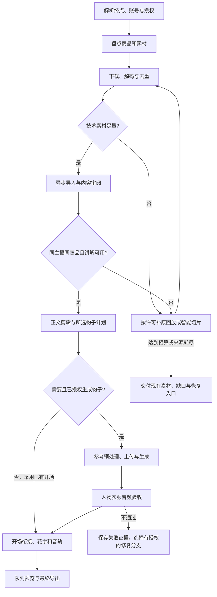

# 流程节点与恢复

把以下节点映射到实际工作流平台。它们是编排设计，不表示已导入旧数据平台或已存在无人值守服务。

`plan` 停在可审阅计划，`materials` 停在下载清单，`handoff` 停在导入核验；只有 `produce` 继续内容编排。图示补料循环必须受次数、来源和预算约束。

## 节点合同

| 节点 | 输入与动作 | 输出和通过条件 |
|---|---|---|
| scope | 从用户要求确定账号、主播、商品或选品权限、模式、声音速度和费用范围；未指定的内容选择沿用默认标准 | `run_id`、明确终点、私有登录配置引用、默认方案及本次覆盖项；不把上次号码默认为本次账号 |
| inventory | 登录检查、子账号查询、该账号商品/视频分页 | 扫描范围、商品候选、切片/原回放/来源数；未扫描完整不宣称全部盘点完成 |
| materials | 按设定数量、时长、来源数、音频与容量限额 `baiying_prepare_materials` | 原 job ID、`materials.json`、`editor_handoff.json`；完整解码、哈希和缺口 |
| import | `media_register` → `media_job_status`，短视频也排队 | `asset_key + sha256 → project/job/asset`，仅取 succeeded 且哈希相符的结果 |
| semantic_review | 实际抽帧、听取/ASR，标记换人换衣、重复、动作与有效句 | 每个可用源区间、人物服装观察、台词证据；技术足量与语义可用分开记录 |
| body | 先建立能兑现主要卖点的正文；已有认可正文保存快照后复用 | 源入出点、声音策略、时间线版本和正文时长；一句话与动作完整 |
| hook_plan | 对话/强调口播模式、台词及依据、拖字重音、可选音效落点、角色、参考、衣服与整片时长 | `hook_plan_create`、账号版本、源哈希、完整 prompt；计划字段按真实 schema 映射，不新增虚构参数 |
| reference | 排队导出参考；按当前支持路线处理并审阅；只上传选中片段 | 原片范围→导出→预处理→上传哈希一致，尺寸/帧率/时长满足当前能力 |
| generate | 免费预览→`hook_request_prepare`→`hook_generation_begin`→授权的一次 create | `may_submit=true` 才创建；保存 task ID、请求指纹、结果哈希，轮询原任务 |
| hook_review | 人物、服装、动作、接缝、事实、音频实物审阅 | `hook_output_review` 逐项证据；失败不能 attach，不以 provider succeeded 替代审阅 |
| compose | 生成钩子在最新 revision 上 `hook_attach`，已有开场按源区间编排；添加音轨、花字及低频装饰转场 | 所有正文事件只偏移一次；全局静音下显式补回钩子声音；效果计数包含叠加层，重叠转场后重新核对时间映射 |
| deliver | validate→队列 preview→检查→队列 final→实物检查 | 本地视频、项目/任务、实际编码器、时长/尺寸/声音、源清单、检查范围和限制 |

## 素材足量的两层判断

技术目标取任务 summary：通过数、计入数、保守时长、独立来源数和缺口。同一原片段与它的切片不重复累计；相似画面只有内容不同且审阅适用才放行计数。

内容目标取真实视听证据：同一主播和这件衣服，完整卖点句，可用展示动作、可接的起止点和可听声音。一个高质量源片可以承载全部正文，不强迫把所有下载文件用进成片。

对于参考实拍讲解风格，再按 [镜头角色与正文区间表](demonstration-editing.md) 检查所需上身、演示、真实细节、颜色/搭配及完整声音。记录角色覆盖与缺口；视频条数够但都缺少目标卖点演示时，仍不能判定正文素材够用。

“3 条、80 秒、2 个原片段”是历史成功选品的启动参数，不保证当前约 45 秒成片及更多重点镜头有足够覆盖。当前成片保持 30 秒以上、60 秒以内，先按 45 秒正文结构和部位演示需求盘点，再在授权预算内补料。不要把 80 秒下载时长等同于 80 秒可用正文。

不足时优先复用已验证素材和未用候选，再按允许范围补原回放、提交百应智能切片。用户已准许择品时可换同账号候选；否则展示缺口与选项。预算耗尽时保留部分交接，不无限生成、不跨账号凑数。

## 恢复与重试

| 状态 | 操作 |
|---|---|
| 短信缺失/会话失效 | 前台说明目标登录身份，只发一次验证码；已有有效登录直接复用；不保存验证码到模板 |
| 下载链接过期或单个下载失败 | 由百应工具刷新链接，`baiying_resume_materials(retry_failed=true)`；保留已通过文件 |
| 百应智能切片 waiting/submitted/unknown | 查询原计划；超时不代表未受理，不另起计划重发；重剪需在用户许可范围内 |
| 素材 partial/needs_input/source_exhausted | 读取 reason/alternatives 和真实缺口；按已有偏好有限补充，保存终点及恢复参数 |
| 导入或参考导出失败/中断 | `media_job_retry` 新 attempt 排队；保存新 ID 与 retry_of，成功文件/证据可复用 |
| resource_wait / queued | 查 `task_queue_list` 与资源原因，等待或按用户要求取消；不放宽内存/CPU保护来强行通过 |
| 渲染失败 | 时间线未改且源文件未变用 `render_retry`，按保存的旧 revision 新建排队 attempt；记录新 job ID 并查询到 `succeeded.result`。改过剪辑则 `render_submit` 新任务 |
| 付费 create 超时未知 | 记录 unknown，核查原提交与服务记录；不可当作未计费再 create |
| 生成成功但下载失败 | 从同一成功 task 的实际 URL 重试下载；不重新生成 |
| 生成失败或衣服/声音验收失败 | 保留结果和原因。可做已授权的本地修剪/混音修复；需新付费尝试时必须有该次授权与新计划 |

衣服变形不能用一句“保持一致”判为已修复。若改成“真实细节画面 + 已生成对白”，须符合用户允许的表现形式，标明它是替代剪法而非生成画面通过；用户明确要生成真人画面时不得暗中替换。

## 资源与生命周期

使用编辑器 GPU 探测结果，`encoder=auto` 尝试当前可用 NVENC/QSV/AMF/VideoToolbox；允许 CPU 回退与否沿用用户设置。硬件编码成功不表示解码、ASR、画图和滤镜全在 GPU。

CPU、内存留量按运行机动态设置。历史任务的线程数与 MiB 数是运行记录，不能固化为所有电脑的最优值。外部预处理须共用 heavy slot 或由编排显式串行且防止其他重任务插入。

保持 MCP 客户端连接直到已排队任务终态；有的宿主断开后会结束子进程。重连后查旧任务再恢复。异步提交并不等于装了独立系统服务，也不保证退出应用后后台持续运行。

## 交付记录

私有运行记录保留账号/商品、源哈希及范围、映射、task/job/attempt、时间线 revision/snapshot、预算消耗、资源事件和验收。可分享的成片报告不带 Cookie、密钥、签名 URL 或主播私有资产 URI。

分别填写自动技术检查、智能体画面抽样、转录、实际试听和用户反馈；未做的检查保持 false/未做。只有文件存在且终态成功才写渲染完成，不把计划或提交状态当成成片。
